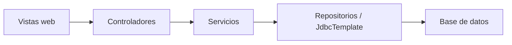
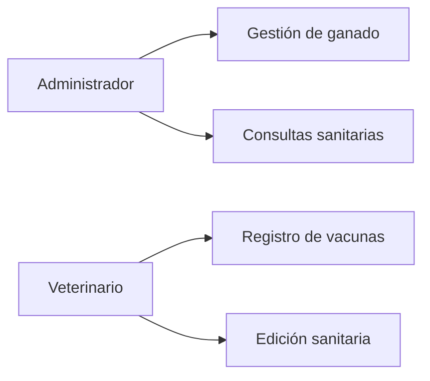
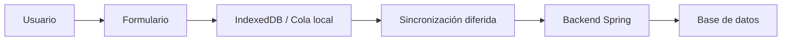
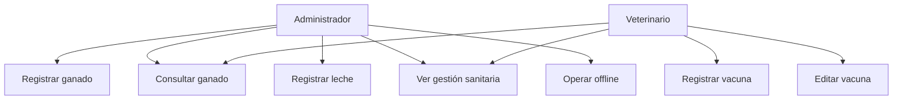
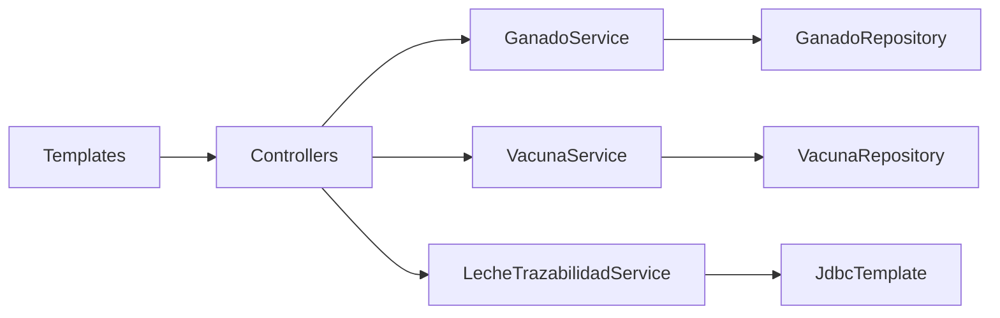
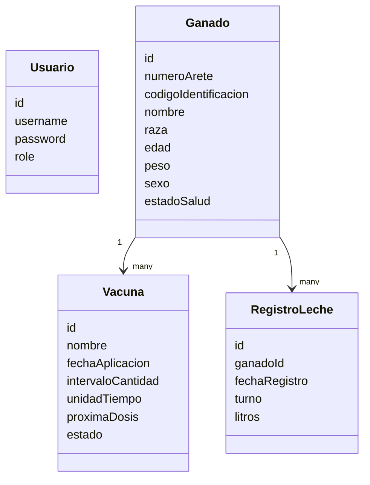
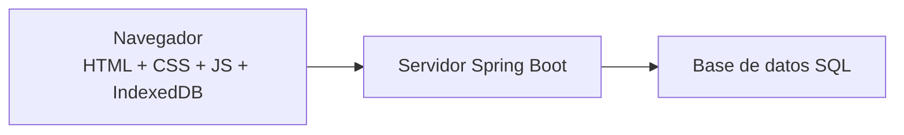

# Documento de Arquitectura de Software

## Proyecto de aula: BoviControl

## 1. Introducción

En este documento presento la arquitectura de software de mi proyecto de aula **BoviControl**, una plataforma web enfocada únicamente en la gestión de ganado bovino. El sistema fue pensado para apoyar procesos como el registro de bovinos, el control sanitario, el manejo de vacunas, la trazabilidad de la leche y la diferenciación de funciones según el rol del usuario.

El propósito de este documento es mostrar de forma detallada las decisiones de arquitectura que tomé para satisfacer los atributos de calidad del sistema. También explico las tácticas, estilos y patrones arquitectónicos que utilicé, y cómo cada uno de ellos ayuda al comportamiento esperado de la aplicación.

Además, incluyo diferentes vistas de arquitectura para mostrar el sistema desde varias perspectivas: funcional, desarrollo, información y despliegue.

---

## 2. Descripción general del sistema

BoviControl es una aplicación web desarrollada para apoyar la administración del hato bovino. El sistema permite:

- iniciar sesión según rol
- registrar bovinos
- controlar duplicados en el registro
- consultar la lista y el detalle de cada animal
- registrar vacunas
- consultar la gestión sanitaria
- llevar trazabilidad de leche
- trabajar parcialmente sin internet mediante sincronización diferida

Los roles principales del sistema son:

- `Administrador`
- `Veterinario`

En el proyecto definí una separación clara entre responsabilidades. El administrador se encarga del registro general del ganado y de la operación administrativa. El veterinario se encarga del manejo sanitario, especialmente el registro y control de vacunas. Esta separación fue una decisión importante de arquitectura porque ayuda a mejorar seguridad, organización y control del sistema.

---

## 3. Atributos de calidad

Para mi proyecto identifiqué varios atributos de calidad importantes. Los más relevantes son los siguientes.

### 3.1 Seguridad

La seguridad es importante porque no todos los usuarios deben hacer lo mismo dentro del sistema. Por ejemplo, el administrador puede gestionar bovinos, pero no debe registrar acciones veterinarias. El veterinario, por su parte, sí puede realizar registros sanitarios.

Por eso necesitaba una arquitectura que permitiera:

- autenticación de usuarios
- control de acceso por rol
- restricción de acciones según permisos

### 3.2 Integridad de datos

En este sistema la información debe mantenerse correcta y consistente. Un bovino no se debe registrar dos veces con el mismo número de arete, ni se deben guardar vacunas con fechas incoherentes o registros repetidos.

Este atributo fue importante porque el proyecto trabaja con:

- inventario del ganado
- historial sanitario
- registros de leche
- fechas que afectan la trazabilidad

### 3.3 Disponibilidad

La disponibilidad en este proyecto no solo significa que el servidor esté activo, sino también que el sistema pueda seguir siendo útil cuando no haya internet. Esto es importante porque el contexto del proyecto está relacionado con entornos rurales, donde puede fallar la conectividad.

Por eso tuve en cuenta una solución offline parcial para que los datos se puedan guardar localmente y sincronizar después.

### 3.4 Usabilidad

La usabilidad fue uno de los atributos que más cuidé, porque el sistema está pensado para usuarios que necesitan una interfaz clara, rápida y fácil de entender. Por eso traté de hacer formularios más limpios, vistas por rol y acciones más directas.

### 3.5 Modificabilidad

La modificabilidad es importante porque el proyecto puede crecer más adelante. Por ejemplo, en el futuro se le pueden agregar módulos de predicción más avanzados, analítica, reportes o nuevos controles sanitarios.

La arquitectura debía permitir hacer cambios sin tener que rehacer todo el sistema.

### 3.6 Trazabilidad

Este atributo es muy importante por la naturaleza del sistema. En BoviControl no solo interesa guardar datos, sino poder seguir la historia del animal: vacunas aplicadas, fechas, producción de leche, estado sanitario y cambios relevantes.

---

## 4. Escenarios de calidad

A continuación presento escenarios de calidad relacionados con los atributos identificados.

## 4.1 Seguridad

### Escenario 1

- **Fuente:** Administrador
- **Estímulo:** intenta registrar una vacuna
- **Entorno:** usuario autenticado dentro del sistema
- **Artefacto:** módulo de vacunas
- **Respuesta:** el sistema bloquea la operación
- **Medida de respuesta:** el administrador no puede ejecutar acciones exclusivas del veterinario

### Escenario 2

- **Fuente:** usuario no autenticado
- **Estímulo:** intenta acceder a una vista interna
- **Entorno:** acceso directo por URL
- **Artefacto:** módulo de autenticación
- **Respuesta:** el sistema solicita inicio de sesión
- **Medida de respuesta:** no se permite el acceso sin credenciales válidas

## 4.2 Integridad de datos

### Escenario 3

- **Fuente:** Administrador
- **Estímulo:** registra un bovino con número de arete repetido
- **Entorno:** formulario de registro de ganado
- **Artefacto:** validación del registro
- **Respuesta:** el sistema detecta duplicado y no guarda
- **Medida de respuesta:** no se crea un registro inconsistente

### Escenario 4

- **Fuente:** Veterinario
- **Estímulo:** intenta guardar una vacuna con fecha futura o muy antigua
- **Entorno:** formulario de vacunas
- **Artefacto:** validación de fecha de aplicación
- **Respuesta:** el sistema rechaza el registro
- **Medida de respuesta:** solo se aceptan fechas dentro del rango definido

## 4.3 Disponibilidad

### Escenario 5

- **Fuente:** Administrador
- **Estímulo:** registra un bovino sin internet
- **Entorno:** navegador en modo offline
- **Artefacto:** cola local IndexedDB
- **Respuesta:** el sistema guarda localmente el registro
- **Medida de respuesta:** el usuario no pierde la información

### Escenario 6

- **Fuente:** navegador
- **Estímulo:** vuelve la conexión a internet
- **Entorno:** existen registros pendientes en cola
- **Artefacto:** módulo de sincronización diferida
- **Respuesta:** el sistema envía la información al backend
- **Medida de respuesta:** disminuye la cola de pendientes y los datos quedan sincronizados

## 4.4 Usabilidad

### Escenario 7

- **Fuente:** Administrador
- **Estímulo:** necesita registrar un bovino
- **Entorno:** jornada normal de trabajo
- **Artefacto:** formulario de registro
- **Respuesta:** el sistema presenta campos claros y directos
- **Medida de respuesta:** el usuario completa el registro con pocas dudas

### Escenario 8

- **Fuente:** Veterinario
- **Estímulo:** consulta el estado sanitario del hato
- **Entorno:** uso diario del módulo sanitario
- **Artefacto:** gestión sanitaria
- **Respuesta:** el sistema organiza la información por alertas y estados
- **Medida de respuesta:** la información puede revisarse rápidamente

## 4.5 Modificabilidad

### Escenario 9

- **Fuente:** desarrollador
- **Estímulo:** se desea agregar un módulo predictivo más avanzado
- **Entorno:** evolución del sistema
- **Artefacto:** capa de servicios
- **Respuesta:** el sistema permite añadir la lógica en una capa separada
- **Medida de respuesta:** el cambio afecta solo partes concretas del proyecto

### Escenario 10

- **Fuente:** docente o cliente
- **Estímulo:** solicita una nueva regla de negocio
- **Entorno:** mantenimiento del software
- **Artefacto:** controladores, servicios y vistas
- **Respuesta:** la arquitectura permite ajustar reglas sin reestructurar toda la aplicación
- **Medida de respuesta:** el impacto del cambio es controlado

---

## 5. Estilos y patrones arquitectónicos utilizados

En mi proyecto decidí usar varios estilos y patrones porque ayudan a organizar mejor la solución y a cumplir los atributos de calidad definidos.

## 5.1 Arquitectura en capas

El estilo principal que usé fue una **arquitectura en capas**. Separé el sistema en:

- capa de presentación
- capa de control
- capa de lógica de negocio
- capa de persistencia
- base de datos

Esto me ayudó porque cada parte tiene una responsabilidad concreta y así el sistema es más fácil de entender, mantener y modificar.

### Fragmento de diagrama que soporta esta decisión



### Relación con atributos

Esta decisión favorece principalmente:

- modificabilidad
- mantenibilidad
- claridad estructural

## 5.2 Patrón MVC

También utilicé el patrón **Modelo Vista Controlador (MVC)** con Spring Boot y Thymeleaf.

- **Modelo:** entidades del sistema como `Ganado`, `Vacuna` y `Usuario`
- **Vista:** plantillas HTML
- **Controlador:** clases que reciben las solicitudes y coordinan el flujo

Elegí MVC porque me permite separar claramente la lógica de interfaz de la lógica de negocio. Esto mejora bastante el orden del proyecto.

## 5.3 Patrón Repository

Utilicé repositorios para encapsular el acceso a datos. Esto hace que los servicios no dependan directamente de cómo se consulta o se guarda en la base de datos.

Con esto favorecí:

- modificabilidad
- mantenibilidad
- desacoplamiento

## 5.4 Service Layer

La lógica de negocio la concentré en la capa de servicios. Ahí están reglas como:

- validación de duplicados
- control de fechas
- cálculo de próxima dosis
- restricciones por rol
- trazabilidad de leche

Esto me ayudó porque las reglas importantes no quedaron regadas por toda la aplicación.

## 5.5 Control de acceso basado en roles

Apliqué un patrón de control por roles para distinguir las funciones del `ADMIN` y del `VETERINARIO`.

Tomé esta decisión porque el proyecto necesitaba restringir acciones específicas y no solo mostrar vistas diferentes.

### Fragmento de diagrama que soporta esta decisión



### Relación con atributos

Esta decisión favorece:

- seguridad
- integridad
- trazabilidad operativa

## 5.6 Patrón de sincronización diferida

Para el trabajo sin internet utilicé una estrategia tipo **store-and-forward**. Cuando no hay conexión:

1. el usuario registra los datos
2. los datos se guardan localmente
3. se agregan a una cola pendiente
4. cuando vuelve internet, el sistema sincroniza

### Fragmento de diagrama



### Relación con atributos

Esta decisión favorece:

- disponibilidad
- continuidad del servicio
- resiliencia

---

## 6. Tácticas de arquitectura

En esta sección explico las tácticas que utilicé para satisfacer los atributos de calidad.

## 6.1 Tácticas para seguridad

### a. Restricción de operaciones por rol

No dejé la seguridad solo en la interfaz. También la implementé en backend. De esta forma, si un usuario intenta entrar manualmente por URL o enviar una petición indebida, el sistema igualmente la rechaza.

### b. Redirección controlada

Cuando el usuario intenta hacer una acción sin permisos, el sistema lo redirige al panel correspondiente y muestra un mensaje claro.

### c. Separación de responsabilidades

La definición de que el administrador vea la parte sanitaria, pero no pueda registrar vacunas, es una táctica que mejora el control del sistema.

## 6.2 Tácticas para integridad de datos

### a. Validación en varios niveles

Realicé validaciones tanto en frontend como en backend. Por ejemplo:

- número de arete
- fechas válidas
- duplicados
- campos obligatorios

### b. Reglas temporales

En vacunas y leche apliqué restricciones por fecha para evitar registros incoherentes.

### c. Restricciones de unicidad

Decidí que el sistema valide duplicados no solo por un dato, sino por varios criterios del negocio, lo que refuerza la consistencia de la información.

## 6.3 Tácticas para disponibilidad

### a. Persistencia local

Usé IndexedDB en el navegador para conservar registros cuando no hay internet.

### b. Cola de sincronización

Toda operación offline queda almacenada en una cola pendiente.

### c. Reintentos

La sincronización diferida incluye reintentos y control de errores, lo que hace el proceso más robusto.

## 6.4 Tácticas para usabilidad

### a. Formularios más limpios

Fui simplificando los formularios para que quedaran más compactos, directos y fáciles de usar.

### b. Vistas según contexto

No todos ven lo mismo ni hacen lo mismo. Esto hace que el sistema se sienta más ordenado.

### c. Feedback visual

Agregué mensajes, estados, avisos de solo lectura, panel de sincronización y alertas visuales.

## 6.5 Tácticas para modificabilidad

### a. Separación de lógica

La lógica de negocio está concentrada en servicios y no en las vistas.

### b. Componentes por responsabilidad

Cada módulo del proyecto tiene su propia función principal.

### c. Uso de capas

La arquitectura en capas facilita cambiar una parte sin dañar las demás.

---

## 7. Vistas arquitectónicas

## 7.1 Vista funcional

La vista funcional muestra lo que hace el sistema desde el punto de vista del usuario.

### Funcionalidades principales

- autenticación
- registro de bovinos
- consulta de lista y detalle
- registro y seguimiento de vacunas
- gestión sanitaria
- registro de leche
- trazabilidad de leche
- sincronización offline

### Diagrama funcional



### Explicación

Esta vista ayuda a entender la separación de funciones por rol, lo cual está directamente relacionado con seguridad, usabilidad e integridad.

---

## 7.2 Vista de desarrollo

La vista de desarrollo representa cómo está organizado el software internamente.

### Estructura general

```text
controller
service
repository
mode
templates
static/js
static/css
```

### Diagrama de desarrollo



### Explicación

Esta organización me ayudó a separar la interfaz, la lógica y el acceso a datos, lo cual favorece especialmente la modificabilidad.

---

## 7.3 Vista de información

La vista de información muestra las entidades más importantes del sistema y su relación.

### Entidades principales

- Usuario
- Ganado
- Vacuna
- Registro de leche

### Diagrama de información



### Explicación

Esta vista es importante para entender la integridad y la trazabilidad del sistema. Muestra claramente que un bovino puede tener múltiples vacunas y múltiples registros de leche.

---

## 7.4 Vista de despliegue

La vista de despliegue muestra dónde se ejecuta cada parte del sistema.

### Nodos principales

- cliente web
- servidor de aplicación
- base de datos

### Diagrama de despliegue



### Explicación

Esta vista permite ver que parte del sistema corre en el navegador y cuál en el servidor. También evidencia que el soporte offline depende de almacenamiento local en el cliente.

---

## 8. Decisiones de arquitectura y justificación

## 8.1 Usar arquitectura en capas

Tomé esta decisión porque el proyecto necesitaba orden y claridad. Al separar presentación, control, lógica y persistencia, el sistema queda más fácil de mantener y ampliar.

## 8.2 Separar funciones por rol

Decidí que el administrador no pudiera registrar vacunas y que el veterinario sí, porque en el contexto del negocio cada rol tiene responsabilidades distintas. Esta decisión fortalece la seguridad y evita errores operativos.

## 8.3 Controlar duplicados en ganado

Elegí validar duplicados porque en el manejo real del hato un registro repetido puede afectar inventario, trazabilidad y consultas futuras.

## 8.4 Limitar fechas sanitarias

Definí reglas para las fechas de aplicación de vacunas porque permitir registros muy antiguos o futuros puede dañar la confiabilidad del historial sanitario.

## 8.5 Soporte offline con sincronización diferida

Esta decisión fue tomada pensando en el contexto rural. Muchas veces no hay internet, por lo tanto el sistema debía seguir siendo útil y guardar la información localmente hasta poder sincronizarla.

---

## 9. Relación entre decisiones y atributos

| Decisión | Seguridad | Integridad | Disponibilidad | Usabilidad | Modificabilidad |
|---|---|---|---|---|---|
| Arquitectura en capas | Media | Media | Baja | Media | Alta |
| MVC | Media | Media | Baja | Alta | Alta |
| Control por roles | Alta | Media | Baja | Media | Media |
| Validación frontend y backend | Alta | Alta | Baja | Media | Media |
| Sincronización diferida | Baja | Media | Alta | Alta | Media |
| Cola local en navegador | Baja | Media | Alta | Media | Media |

---

## 10. Riesgos y mejoras futuras

Aunque la arquitectura actual responde bien al alcance del proyecto, considero que en el futuro se pueden mejorar varios aspectos:

- endurecer completamente la configuración global de seguridad
- agregar auditoría de acciones
- fortalecer la resolución de conflictos en sincronización offline
- integrar un modelo de predicción más avanzado con Weka
- añadir más pruebas automáticas por servicio y por rol

---

## 11. Conclusión

En conclusión, la arquitectura de BoviControl fue diseñada para responder a una necesidad real del entorno ganadero, especialmente en el manejo de bovinos, vacunas, leche y operación por roles.

Las decisiones que tomé, como usar arquitectura en capas, MVC, servicios, repositorios, control de acceso por rol y sincronización diferida, me permitieron construir una solución más ordenada, funcional y alineada con los atributos de calidad definidos.

Considero que esta arquitectura favorece especialmente la seguridad, la integridad de los datos, la disponibilidad en entornos rurales y la posibilidad de seguir ampliando el proyecto en el futuro.

